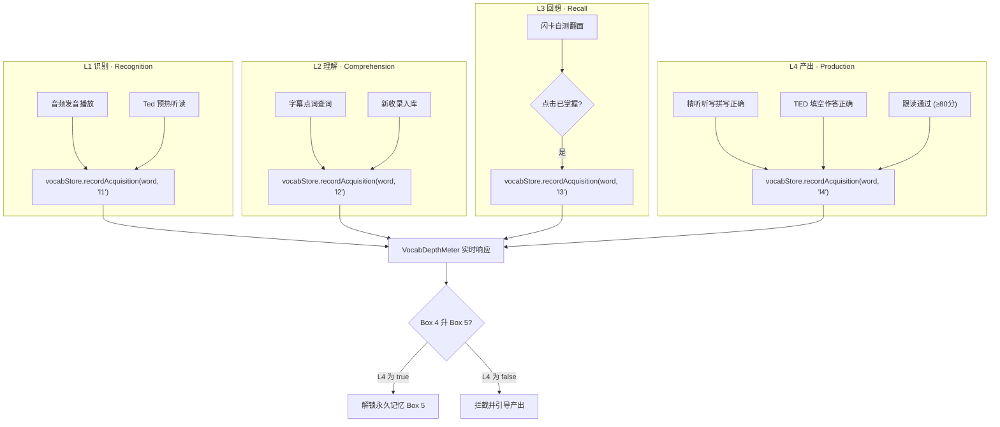

# 智能词汇六维系统与 Nation 四层习得深度追踪 — Sprint 3 设计规范

**版本:** 1.0  
**日期:** 2026-10-15  
**负责人:** Hogwarts Audio Engineering  
**目标学习者:** K12 及以下（≤ 15 岁）  
**关联需求:** `hogwarts-audio-transformation-plan.md` — 五、模块三 智能词汇系统深度重构  

---

## 一、范围与目标

### 1.1 Sprint 3 交付边界（方案 A: 平滑原地迁移 + 响应式四层深度微组件）

Sprint 3 将现有生词本系统从基础「三级标注」全面升级为符合 SLA（第二语言习得）理论的「六维标注体系」与 Nation「四层习得深度追踪（L1–L4）」，实现与 TED 模块、有声书精听、听写与闪卡复习的无缝打通：

| 交付单元 | 核心职责 | 变动类型 |
|---------|---------|---------|
| `src/stores/vocabStore.js` | 扩展 `VocabEntry` 六维字段、平滑数据迁移、L1–L4 习得状态机、Box 5 升级门禁守卫 | 核心增强 |
| `src/data/dictionaryData.js` | 新增 `getCefrLevel(word, tag)` 推导算法，`lookupWord` 返回 `cefrLevel` | 数据字典增强 |
| `src/components/common/VocabDepthMeter.vue` | 4 段式响应式习得深度指示器（L1 识 · L2 懂 · L3 忆 · L4 用），双通道状态展示 | 全新组件 |
| `src/components/VocabularyDrawer.vue` | 词卡展示 CEFR/Tag/来源六维标签、集成 `VocabDepthMeter`、CEFR 过滤、Box 5 守卫提示 | 深度重构 |
| `src/components/session/StepVocabReview.vue` | 闪卡正反面集成深度指示器、L3 翻卡达标触发、Box 5 提升 L4 门禁友好拦截提示 | 交互增强 |
| `src/components/common/WordLookupModal.vue` | 详情弹窗展示 CEFR 徽章、六维深度条、发音听读联动 L1 识别触发 | 交互增强 |
| `tests/vue3/vocabStore.test.js` 等测试套件 | 验证迁移兼容、6 维度属性、L1–L4 触发、Box 5 门禁、UI 组件规格 | 单元与集成测试 |

### 1.2 成功标准（Definition of Done）

- **数据无损兼容**：`localStorage` 中已有的历史生词数据在读取时自动无损填充缺失字段，不发生异常闪退或数据覆盖。
- **六维数据完备**：每个词汇实体具备 `word`, `phonetic`, `pos`, `definition`, `cefrLevel`, `examTag`, `sourceType`, `box`, `acquisition`, `contextQuote` 等完整字段。
- **四层深度追踪**：
  - L1（识别）：听读发音时自动激活。
  - L2（理解）：查词收录或阅读点词时激活。
  - L3（回想）：闪卡复习「已掌握」时激活。
  - L4（产出）：听写拼写或造句跟读正确时激活。
- **Box 5 刚性门禁**：Box 4 升入 Box 5（永久记忆）必须满足 `acquisition.l4 === true`；若未达标则拦截并给出友好引导。
- **设计规范**：100% 严格零 Unicode 表情、Apple HIG 44px 最小可点击面积、温润羊皮纸色调、全量 278+ 测试通过、构建零报错。

---

## 二、数据架构与迁移设计

### 2.1 词汇六维数据模型（`VocabEntry`）

```typescript
interface VocabAcquisition {
  l1: boolean; // 识别 (Recognition) - 听到能识别 (语音听读)
  l2: boolean; // 理解 (Comprehension) - 读到能理解 (查词/阅读确认)
  l3: boolean; // 回想 (Recall) - 看中文写英文 / 闪卡自测 (SRS 已掌握)
  l4: boolean; // 产出 (Production) - 造句/听写正确拼写 (产出验证)
}

interface VocabEntry {
  // 维度 1: 基础词汇信息
  id: number | string;
  word: string;
  phonetic: string;          // IPA 国际音标
  pos: string;               // 词性 (n., v., adj., adv., etc.)
  definition: string;        // 中文释义
  definitionEn?: string;     // 英文释义 (可选)

  // 维度 2: CEFR 语言能力框架分级
  cefrLevel: 'A1' | 'A2' | 'B1' | 'B2' | 'C1';

  // 维度 3: 考纲与专有分类标签
  examTag: '小学基础' | '中考核心' | '高考重点' | '四级高频' | '六级进阶' | '雅思核心' | '魔法专有' | '拓展生词';

  // 维度 4: 来源语境与媒体绑定
  sourceType: 'hp' | 'ted';  // 来源媒体类型
  sourceId?: string;         // 关联的 chapterId 或 talkId
  contextQuote: string;      // 原著或演讲中的例句
  audioTimestamp?: number;   // 音频/视频对应时间戳 (秒)

  // 维度 5: 艾宾浩斯 SRS 记忆盒与复习状态
  box: 1 | 2 | 3 | 4 | 5;    // Leitner Box 等级
  addedAt: number;           // 入库时间戳
  lastReviewedAt: number;    // 上次复习时间戳
  errorCount: number;        // 拼写/自测错误累计次数

  // 维度 6: Nation 习得深度追踪
  acquisition: VocabAcquisition;
}
```

### 2.2 CEFR 映射与推导规则（`getCefrLevel`）

当词汇未显式指定 `cefrLevel` 时，通过考纲标签 `tag` / `examTag` 及词频推导：

| 考纲标签 / 词汇特征 | 推导 CEFR 等级 | 适用学段 |
|-------------------|--------------|---------|
| 小学基础 | `A1` | 启蒙 / 小学 1–6 年级 |
| 中考核心 | `A2` | 初中 7–9 年级 |
| 高考重点 | `B1` | 高中 10–12 年级 |
| 四级高频 | `B2` | 大学基础 / 进阶中学生 |
| 六级进阶 / 雅思核心 | `C1` | 托福雅思 / 高阶精通 |
| 魔法专有 | `B2` | 哈利波特特色文学词汇 |
| 拓展生词 / 默认兜底 | `B1` | 默认通用中间级 |

### 2.3 平滑原地数据迁移策略（`loadVocab()`）

为了保证用户本地已有词库零损坏，`loadVocab()` 加载 localStorage 原始 JSON 时执行幂等规范化：

```javascript
function migrateVocabEntry(raw) {
  const clean = cleanWord(raw.word || '')
  const dict = lookupWord(clean)

  // 1. 考纲标签规范化
  const examTag = raw.examTag || raw.tag || dict?.tag || '拓展生词'

  // 2. CEFR 等级规范化
  const cefrLevel = raw.cefrLevel || getCefrLevel(clean, examTag)

  // 3. 四层习得深度平滑推导 (根据现有 box 原地补偿)
  const defaultAcquisition = {
    l1: true,                     // 已收录说明至少听过/见过
    l2: true,                     // 已收录说明知晓释义
    l3: typeof raw.box === 'number' ? raw.box >= 3 : false, // Box 3+ 代表已有回想能力
    l4: typeof raw.box === 'number' ? raw.box >= 4 : false  // Box 4+ 代表高阶产出
  }

  return {
    id: raw.id || Date.now() + Math.floor(Math.random() * 1000),
    word: clean || raw.word,
    phonetic: raw.phonetic || raw.ipa || dict?.phonetic || '',
    pos: raw.pos || dict?.pos || '',
    definition: raw.definition || dict?.definition || '生词本收录',
    definitionEn: raw.definitionEn || '',
    cefrLevel,
    examTag,
    tag: examTag,                 // 保持向后兼容字段
    sourceType: raw.sourceType || 'hp',
    sourceId: raw.sourceId || '',
    contextQuote: (raw.contextQuote || '').trim(),
    audioTimestamp: typeof raw.audioTimestamp === 'number' ? raw.audioTimestamp : null,
    box: typeof raw.box === 'number' ? Math.min(Math.max(raw.box, 1), 5) : 1,
    addedAt: raw.addedAt || Date.now(),
    lastReviewedAt: raw.lastReviewedAt || raw.addedAt || Date.now(),
    errorCount: typeof raw.errorCount === 'number' ? raw.errorCount : 0,
    acquisition: {
      l1: Boolean(raw.acquisition?.l1 ?? defaultAcquisition.l1),
      l2: Boolean(raw.acquisition?.l2 ?? defaultAcquisition.l2),
      l3: Boolean(raw.acquisition?.l3 ?? defaultAcquisition.l3),
      l4: Boolean(raw.acquisition?.l4 ?? defaultAcquisition.l4)
    }
  }
}
```

---

## 三、Nation 四层深度状态机与触发链路

### 3.1 深度模型与业务动作映射表



### 3.2 `promoteBox(item)` 的 L4 守卫逻辑

```javascript
promoteBox(item) {
  if (!item) return { promoted: false, reason: 'INVALID_ITEM' }
  const clean = cleanWord(typeof item === 'string' ? item : item.word)
  const target = this.vocabList.find((w) => cleanWord(w.word) === clean)
  if (!target) return { promoted: false, reason: 'NOT_FOUND' }

  if (!target.box) target.box = 1

  // Box 4 升 Box 5 刚性门禁：必须满足 L4 (产出能力)
  if (target.box === 4) {
    if (!target.acquisition?.l4) {
      return {
        promoted: false,
        reason: 'NEED_L4_PRODUCTION',
        currentBox: 4,
        message: '需完成听写拼写或造句跟读(L4)方可进入永久记忆盒(Box 5)'
      }
    }
    target.box = 5
    target.lastReviewedAt = Date.now()
    this.saveVocab()
    return { promoted: true, currentBox: 5 }
  }

  if (target.box < 4) {
    target.box += 1
    // Box 3 升级时若尚未标记 L3，自动辅助点亮 L3 (回想成功)
    if (target.box >= 3 && target.acquisition) {
      target.acquisition.l3 = true
    }
    target.lastReviewedAt = Date.now()
    this.saveVocab()
    return { promoted: true, currentBox: target.box }
  }

  return { promoted: false, reason: 'ALREADY_MAX_BOX', currentBox: 5 }
}
```

---

## 四、组件设计与视觉规范

### 4.1 `VocabDepthMeter.vue` 微组件

#### 4.1.1 视觉呈现与双通道指示

每个深度指示器分为 4 格，代表 Nation 词汇习得四个层级：
- **L1 识 (Recognition)**: 听音识别。点亮颜色: `bg-amber-400 text-amber-950 border-amber-500`
- **L2 懂 (Comprehension)**: 语义理解。点亮颜色: `bg-amber-500 text-white border-amber-600`
- **L3 忆 (Recall)**: 闪卡回想。点亮颜色: `bg-amber-600 text-white border-amber-700`
- **L4 用 (Production)**: 产出应用。点亮颜色: `bg-emerald-600 text-white border-emerald-700`
- **未点亮通用基底**: `bg-[#f0ebe1] text-[#a89f91] border-[#e2d9cc]`（温润羊皮纸灰调）

组件提供两种展示形态（通过 `size` prop 控制）：
1. `size="compact"`（生词本列表卡片）：4 个微型药丸格（各长 16px、高 4px），悬浮或点击时显示当前等级描述。
2. `size="full"`（闪卡与查词详情弹窗）：4 个带文字徽章的交互式方块（如 `[识] [懂] [忆] [用]`），包含辅助图标与中文标签。

#### 4.1.2 零 Emoji 与可访问性保证

- 图标使用 `lucide-vue-next`：
  - L1: `Volume2` 或 `Headphones`
  - L2: `BookOpen`
  - L3: `Brain`
  - L4: `PenTool` 或 `Sparkles`
- 具备完整 `aria-label`：例如 `aria-label="词汇习得深度：L1识、L2懂、L3忆已达成，L4用未达成"`。

### 4.2 `VocabularyDrawer.vue` 界面重构

1. **六维徽章集**：
   - 词头区域紧凑呈现：`[CEFR B1]` + `[高考重点]` + `[TED/原著]` 标签。
   - 卡片右上角内嵌 `VocabDepthMeter (compact)`。
2. **CEFR 快速筛选器**：
   - 在已有的 5 个 Leitner Box Tab 下方或右侧，提供 CEFR 筛选选项：`全部` · `A1/A2 (基础)` · `B1/B2 (进阶)` · `C1 (高阶)`。
3. **Box 5 升级防护交互**：
   - 卡片「熟记 +1」按钮：当词汇处于 Box 4 且 `!l4` 时，按钮显示为带有锁形提示的友好提醒样式（例如「需L4」或点击后弹出温和 Toast：「请在听写或跟读中正确拼写一次以点亮 L4 产出能力」）。

### 4.3 `StepVocabReview.vue` 界面增强

- 闪卡背面展示 `VocabDepthMeter (full)`。
- 点击「已掌握」时，触发 `promoteBox()`。若返回 `NEED_L4_PRODUCTION`，卡片下方展示金铜色提示条：「该词已达 Box 4，完成一次听写产出(L4)后即可荣升 Box 5 永久记忆！」。

### 4.4 `WordLookupModal.vue` 界面增强

- 弹窗顶部呈现 CEFR 级别彩色药丸徽章。
- 若该词已存在于生词本，显示「已收录 · Leitner Box X」，并展示 `VocabDepthMeter (full)`。
- 点击发音朗读按钮不仅播放发音，同时触发 `vocabStore.recordAcquisition(word, 'l1')`。

---

## 五、测试规划与质量门禁

### 5.1 单元测试矩阵（`tests/vue3/vocabStore.test.js`）

1. **迁移兼容性测试**：
   - 验证无 `acquisition` / 无 `cefrLevel` 的旧数据加载后被正确平滑填充。
   - 验证旧数据各字段原值完备保留，不发生丢失。
2. **六维属性与推导测试**：
   - 验证 `getCefrLevel` 对小学、中考、高考、四六级、雅思、魔法词汇的映射断言。
   - 验证新词录入时各维度默认值正确生成。
3. **L1–L4 状态迁移测试**：
   - 验证 `recordAcquisition(word, 'l1'|'l2'|'l3'|'l4')` 幂等修改。
   - 验证无效参数安全防御。
4. **Box 5 升级门禁测试**：
   - 验证 Box 1->2->3->4 正常升盒。
   - 验证当 `l4 === false` 时，Box 4->5 升级被拦截并返回指定错误码。
   - 验证当 `l4 === true` 时，Box 4->5 升级顺利通过。

### 5.2 组件规格测试

1. `tests/vue3/vocabDepthMeter.test.js`：
   - 验证渲染 4 个对应层级格，测试 compact 与 full 两种模式。
   - 验证零 Unicode Emoji、无样式溢出。
2. `tests/vue3/vocabularyDrawer.test.js`：
   - 验证六维标签渲染、CEFR 过滤、Box 5 守卫按钮响应。
3. `tests/vue3/stepVocabReview.test.js`：
   - 验证闪卡深度指示器与 L4 拦截友好提示。

---

## 六、实施任务分解概要

1. **Task 1: CEFR 推导工具与词典升级**（`dictionaryData.js`, `vocabCefr.test.js`）
2. **Task 2: vocabStore 六维扩展、数据迁移与 L4 门禁**（`vocabStore.js`, `vocabStore.test.js`）
3. **Task 3: VocabDepthMeter.vue 四层深度微组件**（`VocabDepthMeter.vue`, `vocabDepthMeter.test.js`）
4. **Task 4: VocabularyDrawer.vue 六维系统与 CEFR 筛选升级**（`VocabularyDrawer.vue`）
5. **Task 5: StepVocabReview.vue 深度指示器与 Box 5 交互增强**（`StepVocabReview.vue`）
6. **Task 6: WordLookupModal.vue 深度指示与 L1 联动**（`WordLookupModal.vue`）
7. **Task 7: 全链路集成验证与测试收敛**（`npm test`, `npm run build`, `npm run check-emojis`）
