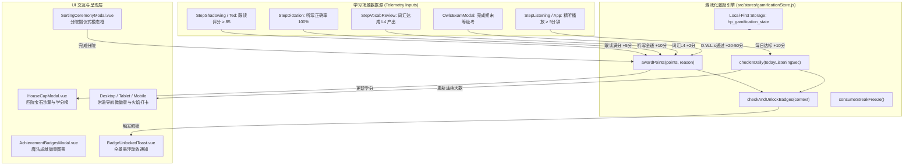

# Sprint 5 — 魔法激励系统与成就徽章设计说明书
## Gamification, House Cup & Achievement Badges System Specification

> **版本**：v1.0  
> **日期**：2026-10-16  
> **定位**：霍格沃茨魔法英语学习平台 · Sprint 5 游戏化激励引擎  
> **设计系统**：严格遵守 `educational-ui-spec` 与 `refactoring-ui-spec`（零 Unicode Emoji，暖色羊皮纸调性，Apple HIG 44px 触控标准，Duolingo 式正向微动效反馈）

---

## 一、教育学背景与设计愿景

第二语言习得（SLA）研究表明，语言习得是一个长期、渐进的过程，学习者的**情感过滤假说（Affective Filter Hypothesis）**与**内在动机维持（Self-Determination Theory）**是决定持续投入的核心要素。

现有平台经过 Sprint 1–4 建设，已拥有了完善的「输入-理解-产出-巩固」闭环与 CEFR 评定体系。然而，日常持续坚持学习仍存在遗忘曲线与意志力消耗的挑战。Sprint 5 旨在通过哈利·波特核心 IP 中的**四大学院杯（House Cup）学分竞赛**、**连续打卡（Streak）守护神保护**与**多维度魔法成就徽章（Badges Gallery）**，构建具备沉浸仪式感、低认知负荷、杜绝惩罚性挫败感的激励闭环。

---

## 二、系统总体架构与数据流图



---

## 三、核心数据结构与 Pinia Store 设计

### 3.1 状态模型 (`src/stores/gamificationStore.js`)

```javascript
export const STORAGE_KEY_GAMIFICATION = 'hp_gamification_state'

export const HOUSES = {
  gryffindor: {
    id: 'gryffindor',
    name: '格兰芬多',
    enName: 'Gryffindor',
    qualities: '勇气、魄力、骑士风范',
    gemName: '红宝石 (Ruby)',
    gemColor: '#991b1b', // crimson
    primaryColor: '#b91c1c',
    bgColor: '#fef2f2',
    borderColor: '#fca5a5',
    icon: 'Flame',
    quote: 'Where dwell the brave at heart, their daring, nerve, and chivalry set Gryffindors apart.'
  },
  ravenclaw: {
    id: 'ravenclaw',
    name: '拉文克劳',
    enName: 'Ravenclaw',
    qualities: '睿智、学识、敏锐洞察',
    gemName: '蓝宝石 (Sapphire)',
    gemColor: '#1e40af', // midnight blue
    primaryColor: '#2563eb',
    bgColor: '#eff6ff',
    borderColor: '#93c5fd',
    icon: 'BookOpen',
    quote: 'Where those of wit and learning, will always find their kind.'
  },
  hufflepuff: {
    id: 'hufflepuff',
    name: '赫奇帕奇',
    enName: 'Hufflepuff',
    qualities: '正直、坚韧、忠诚不渝',
    gemName: '黄晶石 (Topaz)',
    gemColor: '#b45309', // warm amber
    primaryColor: '#d97706',
    bgColor: '#fffbeb',
    borderColor: '#fcd34d',
    icon: 'Heart',
    quote: 'Where they are just and loyal, those patient Hufflepuffs are true and unafraid of toil.'
  },
  slytherin: {
    id: 'slytherin',
    name: '斯莱特林',
    enName: 'Slytherin',
    qualities: '雄心、谋略、追求卓越',
    gemName: '祖母绿 (Emerald)',
    gemColor: '#166534', // forest green
    primaryColor: '#15803d',
    bgColor: '#f0fdf4',
    borderColor: '#86efac',
    icon: 'Crown',
    quote: 'Where you\'ll make your real friends, those cunning folk use any means to achieve their ends.'
  }
}
```

```javascript
state: () => ({
  // 1. 所选学院状态（初始未分院为 null）
  userHouse: null,          // 'gryffindor' | 'ravenclaw' | 'hufflepuff' | 'slytherin' | null
  sortedAt: null,           // timestamp

  // 2. 学院杯四院总积分
  housePoints: {
    gryffindor: 180,
    ravenclaw: 175,
    hufflepuff: 165,
    slytherin: 190
  },
  studentContribution: 0,   // 本人累计为学院赚取的积分
  pointHistory: [],         // [{ id, points, reason, timestamp }] 限制最近 50 条

  // 3. 连续打卡与保护
  streakDays: 0,
  lastActiveDate: null,     // 'YYYY-MM-DD'
  dailyGoalSeconds: 300,    // 5 分钟每日微契约
  streakFreezes: 1,         // 守护神冷冻符（初始赠送 1 枚，上限 2 枚）
  streakFrozenDates: [],    // 消耗冷冻符保护的日期清单

  // 4. 成就徽章解锁清单
  unlockedBadges: {},       // { [badgeId]: { unlockedAt: number, seen: boolean } }

  // 5. 待弹窗动效队列
  pendingToasts: []         // [{ id, type, title, subtitle, icon, house }]
})
```

---

## 四、学分与成就规则定义

### 4.1 学分获取与沙漏竞赛规则

1. **积分触发矩阵**：
   - `精听达标`：当天累计精听时间达到 300 秒（5分钟），立即奖励 **+10 学分**并触发今日打卡完成；
   - `口语突破`：原声影子跟读单句评分 ≥ 85，奖励 **+5 学分**；
   - `生词掌握`：生词在学习流中首次达成 L4 产出，奖励 **+2 学分**；
   - `听写拔尖`：单次章节听写全部正确，奖励 **+10 学分**；
   - `期末大考`：完成一次 O.W.L.s 等级综合评定，及格 (A) **+20 分**，良好 (E) **+35 分**，卓越 (O) **+50 分**。
2. **沙漏视觉高度计算**：
   - 设四院最高分为 $M$，基准总容积高 140px，各学院沙漏宝石填充高度按 $H_i = \max(15, \min(130, \text{round}(P_i / M \times 120)))$ 像素动态投影。

### 4.2 连续打卡与「守护神护盾」容错算法

- 当日有有效学习且日期等于今日（`formatDate(new Date())`）：
  - 若 `lastActiveDate === yesterday`：`streakDays = streakDays + 1`；
  - 若 `lastActiveDate === today`：维持现有 `streakDays`（幂等防重算）；
  - 若 `lastActiveDate < yesterday`（即昨天断卡）：
    - 若 `streakFreezes > 0`：自动消耗 1 枚冷冻符，记录 `streakFrozenDates.push(yesterday)`，`streakFreezes--`，保持打卡不归零，并入队一条保护提醒；
    - 若无可用冷冻符：断签，`streakDays = 1`。
- 每当连续打卡达到 7 的整数倍（7 天、14 天、21 天...），自动奖励 1 枚冷冻符（不超过 2 枚上限）。

### 4.3 魔法成就徽章元数据清单 (`src/data/badgeDefinitions.js`)

| 徽章 ID | 称号名称 | 类别 | 稀有度 | 解锁条件 | 视觉图标 |
|---|---|---|---|---|---|
| `sorting-ceremony` | 分院礼赞 | journey | bronze | 完成分院仪式选定学院 | `GraduationCap` |
| `first-journey` | 破釜启程 | journey | bronze | 首次完成第 1 章精听或泛听 | `BookOpen` |
| `streak-3` | 荧光闪烁 | grit | bronze | 连续打卡学习达到 3 天 | `Flame` |
| `streak-7` | 烈火熊熊 | grit | silver | 连续打卡学习达到 7 天 | `Flame` |
| `streak-30` | 傲罗毅力 | grit | gold | 连续打卡学习达到 30 天 | `Shield` |
| `patronus-shield` | 呼神护卫 | grit | silver | 首次使用守护神冷冻符保住连续打卡 | `Sparkles` |
| `ear-master-1` | 听风密语 | skill | bronze | 累计精听总时长达到 60 分钟 | `Volume2` |
| `ear-master-10` | 音律通幽 | skill | gold | 累计精听总时长达到 600 分钟 (10h) | `Headphones` |
| `shadowing-85` | 纯正英音 | skill | silver | 影子跟读单次得分达到 85 分以上 | `Mic` |
| `vocab-50` | 羊皮卷轴 | skill | bronze | 词汇本总收录生词达到 50 词 | `BookMarked` |
| `vocab-l4-20` | 妙笔生花 | skill | gold | 达成 L4 产出能力的词汇达到 20 词 | `PenTool` |
| `dictation-ace` | 绝不手抖 | skill | silver | 章节单词听写取得 100% 正确率 | `Check` |
| `owls-pass` | 巫师评定 | owls | silver | 首次完成 O.W.L.s 等级综合评定 | `Award` |
| `owls-outstanding` | 卓越巫师 (O) | owls | legendary | O.W.L.s 综合测验取得 Outstanding 卓越认证 | `Crown` |

---

## 五、UI 组件设计规范

### 5.1 `SortingCeremonyModal.vue`（分院帽仪式）
- **功能**：
  - 首次进入或用户主动重选时弹出；
  - 顶部羊皮纸插图与分院帽文案；
  - 4 题测验交互（每题 4 个选项映射四院倾向分，答完自动高亮最高契合学院）；
  - 或下方直接切换「自主择院」卡片网格；
  - 点击「确认入席」触发 `gamificationStore.selectHouse(houseId)`，播放入场微动画与徽章解锁。

### 5.2 `HouseCupModal.vue`（学院杯沙漏看板）
- **功能**：
  - 展示四大学院总分沙漏柱（带彩色宝石粒子效果与透明反光弧线）；
  - 学院排名榜单：第 1 至第 4 名卡片，高亮自身学院；
  - 个人贡献统计区块：已赚取学分、今日学分、打卡火焰天数；
  - 最近学分流水日志表格。

### 5.3 `AchievementBadgesModal.vue`（成就图鉴大厅）
- **功能**：
  - 分类切换 Tab：全部、魔法征程、语言造诣、坚韧修行、O.W.L.s 优异；
  - 网格布局（手机 2 列、平板 3 列、桌面 4 列）；
  - 未解锁状态显示锁形图标与当前进度（如 `3/7 天`、`45/60 分钟`）；
  - 点击任意徽章卡片展开详情弹层，查阅设计典故与获得时刻。

### 5.4 `BadgeUnlockedToast.vue`（全局浮动荣誉通知）
- **功能**：
  - `Teleport to="body"`，固定在视图顶部中央（避开移动端 safe area）；
  - 具备金色渐变微边框、Duolingo 风格上浮弹出与平滑淡出；
  - 提供关闭按钮与点击直接查阅成就大厅。

### 5.5 三端导航触点增强
- **桌面端** (`DesktopSidebarVue.vue`)：
  - 左下角原有简陋打卡卡片升级为正规学院杯卡片：显示院徽、学院积分、连续天数与今日 5 分钟契约进度环，点击打开 `HouseCupModal` 或 `AchievementBadgesModal`。
- **平板端** (`TabletRailVue.vue`)：
  - 侧栏增加 `Trophy` 与 `Flame` 触控图标（44×44px）。
- **手机端** (`MobileTopBarVue.vue`)：
  - 顶栏右侧工具区嵌入微型火焰徽章与学院宝石图标。

---

## 六、工程质量保证与测试矩阵

1. **测试驱动开发（TDD）**：
   - `tests/vue3/gamificationStore.test.js`：学院选择、学分累加与排名、Streak 计算、守护神冷冻符自动保护、7 天冷冻符奖励、徽章扫描逻辑；
   - `tests/vue3/sortingCeremony.test.js`：分院仪式测试题目选择、学院推荐、直接择院、入选后初始化；
   - `tests/vue3/houseCupModal.test.js`：四院沙漏高度数学比例映射、排行榜高亮自身学院、个人贡献指标；
   - `tests/vue3/achievementBadges.test.js`：徽章网格渲染、分类 Tab 过滤、锁定进度展示、徽章解锁状态；
   - `tests/vue3/gamificationTelemetry.test.js`：全链路学习动作注入学分与自动判定徽章。
2. **零 Emoji 审计**：`npm run check-emojis` 确保 0 Unicode 字符。
3. **安全凭据审计**：`npm run verify-security` 确保 0 密钥泄露。
4. **构建无损**：`npm run build` 零报错零警告。
5. **回归防线**：现有 330 项测试必须 100% 保持绿色通过。
