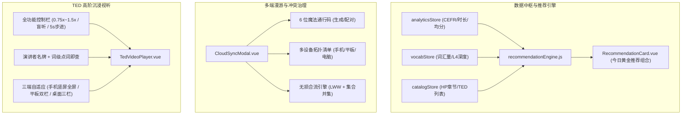

# Sprint 6 技术设计规范：Hogwarts Audio 3.0 终极全景整合
## 智能推荐引擎 · 六位通行码多端漫游 · TED 高阶沉浸视听

> **规范版本：** 1.0.0  
> **制定日期：** 2026-10-16  
> **实施分支：** `main`  
> **核心原则：** SLA 第二语言习得闭环 · 本地优先多端漫游 · 纯原生零第三方依赖 · 严格零 Emoji · 严守 Apple HIG 44px 靶心规范

---

## 1. 业务目标与架构全景

经过 Sprint 1 至 Sprint 5 的持续演进，平台已具备音视频双轨学习流、艾宾浩斯 6 维生词本、CEFR 能力雷达与 O.W.L.s 评定考、以及学院杯四院沙漏激励体系。  
**Sprint 6** 作为 3.0 版本的终极收官冲刺，旨在打通「数据驱动推荐」、「多设备漫游可视化」与「TED 视听沉浸极致」三大核心闭环，使整个平台形成浑然一体的现代教育科技体验。



---

## 2. 模块一：智能推荐「下一步」引擎 (`recommendationEngine.js` & `RecommendationCard.vue`)

### 2.1 推荐算法数学模型
推荐引擎接收学习者当前各项学业指标，输出**最适合当前水平（$i+1$ 原则）**的一对学习任务：
1. **1 个 HP 有声书原著章节**
2. **1 期匹配主题的 TED 演讲视频**

**候选评分函数：**
$$\text{Score}(item) = W_{\text{cefr}} \cdot S_{\text{cefr}} + W_{\text{prog}} \cdot S_{\text{prog}} + W_{\text{vocab}} \cdot S_{\text{vocab}}$$

* **$S_{\text{cefr}}$ 难度适配分（权重 0.45）**：
  - 若 $item.cefr == user.cefr$，得 100 分；
  - 若 $item.cefr == user.cefr + 1$（挑战项），得 85 分；
  - 若 $item.cefr < user.cefr$（复习项），得 70 分；
  - 其余得 40 分。
* **$S_{\text{prog}}$ 进度承接分（权重 0.35）**：
  - 寻找用户尚未完成（`completed: false`）的最近一章，若紧跟上一已学章节，得 100 分。
* **$S_{\text{vocab}}$ 词汇关联度（权重 0.20）**：
  - 根据该内容包含的重点词与用户处于 L1~L3 阶段（尚未完全掌握 L4）的交集量计算得分。

### 2.2 推荐理由透明化生成逻辑
系统根据得分最高维度的特征，为学生生成一条具有教育学温度的推荐理由：
- **进阶挑战型**：“你在前序章节中跟读评分达到 {score} 分，推荐开启 {cefr} 级更高阶原著挑战！”
- **进度承接型**：“承接上次学习的 {lastTitle}，继续探索霍格沃茨故事发展。”
- **词汇强化型**：“本章节包含你正在复习的 {count} 个重点考纲词汇，建议在真实原声语境中强化记忆。”

### 2.3 `RecommendationCard.vue` 视觉与交互规范
- **布局结构**：
  - 顶部：魔法水晶球图标（Lucide `Sparkles` 或 `Compass`），“今日校长推荐 · 黄金研习组合”。
  - 双卡网格：左卡（HP 原著有声书），右卡（TED 思想演讲）。
  - 卡片内部：包含 CEFR 标识胶囊（A2 翠绿、B1 浅海蓝、B2 皇家蓝、C1 紫金）、时长/语速、推荐理由胶囊、一键直达行动按钮。
- **三端交互**：
  - 手机端：垂直堆叠双卡，滑动自如。
  - 平板/桌面端：双列并排卡片，高度对齐。
  - 点击「立即开启」：直接调度 `catalogStore.selectBook/selectChapter` 或 `catalogStore.selectTedTalk` 并平滑跳转至播放工作台。

---

## 3. 模块二：六位通行码多端漫游与冲突治理 (`CloudSyncModal.vue`)

### 3.1 六位魔法通行码（Passcode）生命周期
- **生成规则**：6 位大写英数混淆（排除容易混淆的 `0/O`, `1/I`，如 `HP-7892`、`WIZ-4K8` 或 `8X3N9P`）。
- **配对机制**：
  - 用户在设备 A 点击「生成我的通行码」，本地持久化并生成可一键复制的代码。
  - 在设备 B 输入该 6 位代码，向 Cloudflare Worker / D1 发起配对验证并建立双向数据桥。

### 3.2 多设备拓扑可视化清单
- 实时呈现已关联设备：
  - 设备类型感知：利用 UserAgent 自动匹配手机（`Smartphone`）、平板（`Tablet`）、电脑（`Laptop`）。
  - 设备名称与在线状态：如 “iPhone 15 Pro · 当前设备”、“iPad Pro · 10分钟前活跃”、“MacBook Air · 昨天同步”。
  - 解绑与踢出功能：支持单向安全接触配对。

### 3.3 数据多端合流与无损冲突治理 (Lossless Merging)
当云端拉取的数据与本地产生差异时，采取非阻塞的无损合并策略：
- **生词本 (`vocabList`)**：并集（Union）去重，相同词条对比 `updatedAt` 时间戳，保留最新掌握状态（LWW: Last-Write-Wins），且高阶习得状态（如 L4）优先保留。
- **连续打卡 (`streakDays`)**：取本地与云端 `Math.max(local, cloud)`，避免因不同步导致断签挫败。
- **学分与流水 (`pointHistory`)**：按记录 ID 与时间戳去重合并，学分累加。
- **徽章解锁 (`unlockedBadges`)**：并集保留，只要任一端解锁即全端点亮。
- **UI 反馈**：触发数据合并时，弹出不打扰的温和 Toast（`CheckCircle2` + “多端学业数据已自动无缝漫游合并”）。

### 3.4 交互触发入口
- 桌面侧边栏底部的同步指示绿点；
- 平板与手机端顶部工具栏快捷入口；
- 模态框符合 Apple HIG 44px 靶心与全键盘 Esc 关闭规范。

---

## 4. 模块三：TED 视频高阶沉浸视听体验 (`TedVideoPlayer.vue` & `TedSubtitles.vue`)

### 4.1 全功能自适应控制栏
在原有播放/暂停基础上，扩展全套教育级专业控件：
```
[后退5s]  [0.75x | 1x | 1.25x | 1.5x]  [播放/暂停]  [前进5s]  [双语/英文/中文/关]  [盲听遮罩]  [全屏]
```
- **快捷快退/快进**：前后 5 秒精准微调（Lucide `RotateCcw` / `RotateCw`），适合听不清时的即时倒回。
- **变速不变调**：支持 0.75x（基础巩固）、1.0x（原速）、1.25x（提速挑战）、1.5x（高级泛听），结合 HTML5 `playbackRate` 原生支持。
- **多轨字幕模式切换**：一键循环切换「英汉双语」$\rightarrow$「纯英文字幕」$\rightarrow$「纯中文辅助」$\rightarrow$「无字幕盲听」。
- **盲听毛玻璃（Blind Mask）**：一键开启视频画面与字幕的高斯模糊，强制调动听觉感知神经。
- **全屏沉浸（Fullscreen）**：调用 Fullscreen API 实现真正的剧院式视听。

### 4.2 演讲者名牌与词级点词即查闭环
- **演讲者名牌（Speaker Badge）**：
  - 字幕中动态标注当前讲话者姓名与时间锚点（如 `Simon Sinek · 03:15`），增强演讲语境真实感。
- **字幕文本交互分词化**：
  - 字幕中的所有英文单句，按词元化切分（Tokenized）。
  - 单击任意词汇即时弹出 `WordLookupModal`，展示 CEFR 等级、音标、释义及 6 维掌握度。
  - 提供一键「收录至生词本」按钮，并将来源标签标记为 `'ted'`，实现看视频与背单词的即时内联。

### 4.3 三端响应式视听工作台布局
- **手机端（< 768px）**：
  - 顶部固定 16:9 播放器（支持展开为沉浸式全屏），下方为独立滚动的双语精读流，单手操作防误触。
- **平板端（768px ~ 1023px）**：
  - 经典的双栏黄金分割（左侧 55% 视听播放区，右侧 45% 智能字幕与核心词汇流）。
- **桌面端（$\ge$ 1024px）**：
  - 完整的三栏学术工作台：
    - 左栏：TED 演讲精选目录与难度标签（280px）
    - 中栏：超清视频舞台与控制栏（Flex-1）
    - 右栏：互动字幕、核心生词提炼与笔记工坊（360px）

---

## 5. 设计系统、人体工学与安全基线

1. **严格零 Emoji 原则**：所有界面图标均使用 `lucide-vue-next`，严禁任何 Unicode Emoji 字符。
2. **Apple HIG 人体工学**：所有可点击控件、按钮、标签均保证 `min-h-[44px] min-w-[44px]` 最小触控区域与 `touch-manipulation` 响应。
3. **暖羊皮纸设计系统**：严格继承 `#fbf9f5` 暖底、`#e8ddd0` 边框、琥珀/古铜主题色以及深石灰文字。
4. **离线优先与数据安全**：无网络时完全依赖 IndexedDB (`HogwartsOfflineDB`) 与 localStorage，绝不阻塞用户核心学习流程；零 Cloudflare 凭据泄露。

---

## 6. 测试与验证策略 (TDD)

1. **测试用例规划**：
   - `tests/vue3/recommendationEngine.test.js`: 验证算法在各 CEFR 阶段、新旧用户、词汇交集下的加权计算准确性及透明理由生成。
   - `tests/vue3/recommendationCard.test.js`: 验证 `RecommendationCard.vue` 的渲染、响应式类名、交互点击与零 Emoji。
   - `tests/vue3/cloudSyncModal.test.js`: 验证通行码生成、设备识别、数据合并函数（并集/LWW）与弹窗关闭生命周期。
   - `tests/vue3/tedAdvancedPlayer.test.js`: 验证倍速切换、前后 5 秒快进快退、字幕轨道切换、盲听模式、点词交互及全键盘支持。
2. **全量回归保障**：
   - 保持现有 391 项测试 100% 通过（0 回归）。
   - 运行 `npm run check-emojis` 确保 0 违规。
   - 运行 `npm run verify-security` 确保 0 泄露。
   - 运行 `npm run build` 确保生产构建打包零报错。
